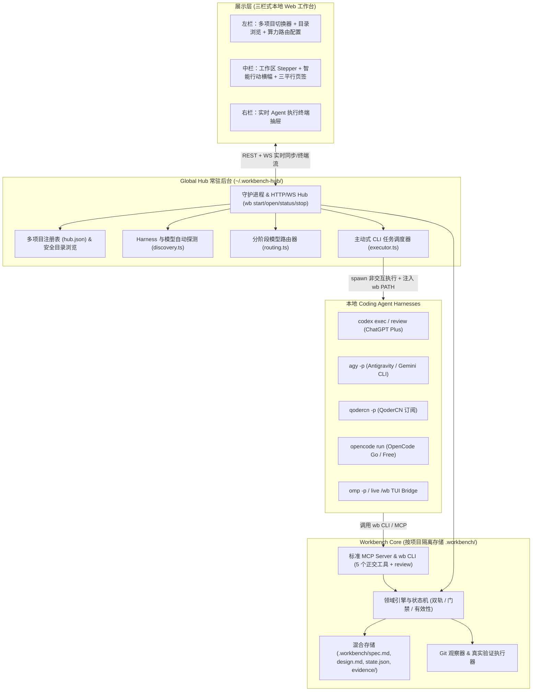

# Workbench 架构与产品设计规范（v6.0：单主程闭环 + 项目级双档路由 + 盲审架构）

> 状态：当前权威设计基线（v6.0 收敛版：常驻多项目 Hub 守护进程 + Headless Core + 项目级 3 角色双档路由 + 三栏式本地 Web 工作台）。  
> 文档分工：本文定义产品定位、工作流、三层解耦与多 Harness 路由架构、三栏式界面信息架构及通用工具接口；数据与领域不变量见 [DOMAIN_CONTRACT.md](DOMAIN_CONTRACT.md)；旧版架构与历史文档已归档至 [archive/README.md](archive/README.md)。

---

## 1. 产品定位与核心设计哲学（Lightweight SDD + VDD）

**定位**：本地优先、常驻运行、Agent 无关的**轻规范与验证驱动交付工作台（Spec & Verification Workbench Hub）**。它不是另一个聊天客户端，也不是繁琐的行政审批后台，而是开发者统筹**多个本地 Git 项目与多份 AI 订阅算力**、对齐意图、调度最佳模型执行与审阅真实交付证据的控制中心。

**核心公式**：

> **清晰意图（Living Spec） + 弹性执行（Adaptive Track） + 分阶段最优模型路由（Quota-Smart Routing） + 真实证据（Verification Proof） + 两头人工拍板（Human Checkpoints）**

### 1.1 五大核心原则

1. **Agent 填表搬砖，人类阅读拍板**
   - 彻底消灭用户作为“人肉中间件”的手工操作；用户只需用一句话描述目标，标题拆解、范围界定、验收条件梳理、方案撰写、步骤更新与测试运行，全部由选定的 Agent Harness 自动完成。
2. **守住两头，放开中间**
   - 不对 Agent 的每一次文件修改做繁琐审批。人类只守住真正决定工程质量的两道关口：
     1. **写代码前**：审阅并批准规范/方案（或显式授权走快速通道）。
     2. **交付完成前**：审阅真实的验证命令证据（`Verification Evidence`）、代码差异（`Git Diff`）与可选的跨模型审查报告（`Cross-Model Review`），点击验收通过。
3. **极简 4 态生命周期与双轨流转（Plan-First vs Fast-Track）**
   - **持久状态（仅 4 态）**：`planning` → `coding` → `done` / `cancelled`（"待批准"、"验证失败"、"待验收"均由 `designHash`、`approval`、`evidence` 实时派生）。
   - **标准模式（Plan-First）**：`planning`（调研并编写 `spec.md` / `design.md` 及可选内联 ```` ```workbench-criteria ```` JSON 块）→ 人类批准 → `coding`（编码 + 自动验证 + 可选异构盲审）→ 人类验收 → `done`。
   - **快速通道（Fast-Track）**：针对明确小需求，人可从 `planning` 直接授权跳过方案审批进入 `coding`；编码完成后仍须经过同等严格的**真实验证证据 + 人工验收**闭环。
   - **设计阶段执行边界**：`design` 阶段允许运行只读测试或检查命令复现问题与调研现状，直接编辑 `spec.md`、`design.md` 后结束本轮即可；宿主执行器在退出后自动同步为提案并交由人类审阅。核心引擎在批准前仍拒绝记录验证证据，Hub 对 `implement` / `fix` 强制校验阶段与有效审批。
4. **零废话 UI（Zero-Noise Interface）**
   - 主界面只展示**业务事实**（需求目标、方案正文、档位标记 `Standard / SOTA`、验证绿/红状态、代码 Diff、防测试篡改告警与跨模型审查结论）和**当前唯一核心行动建议 + 执行器选择**。
   - 彻底清除免责说教、内部 UUID、SHA-256 指纹与协议术语；调试信息统一收纳于「更多 → 查看调试信息」。
5. **项目级零兜底路由与「双档单主程 + 盲审」架构**
   - **项目级彻底收口**：`hub.json` 不再保存全局路由或预设；项目初始化时根据本机已安装 CLI 自动生成显式 `routing` 写入 `.workbench/project.json`，运行时仅读取项目自身路由，彻底消除跨项目隐式回落。
   - **3 角色极简路由**：每个项目仅配置 **`defaultLead`（常规主力主程）**、**`sotaLead`（SOTA 旗舰主程）**、**`reviewer`（独立异构盲审专家）** 以及 `autoReview` / `autoHeal` 开关，每个角色独立配置跨订阅 `fallbacks` 容灾链。
   - **人工控制 SOTA 额度边界**：需求默认 `tier: "standard"`，由 `defaultLead` 同模型端到端执行 `ask/design/implement/fix` 并复用原生会话，自动自愈与 429 容灾严格限制在同档位 `fallbacks` 内，绝不自动消耗 `sotaLead` 额度；仅当人类显式切换 SOTA 档位或点击「升级 SOTA 主程接管」时才启用 `sotaLead`。

---

## 2. 系统总体架构（常驻 Hub + 多 Harness 执行 + 核心引擎）

在原有 `Workbench Core + MCP/CLI + Local Web UI` 单一 TypeScript / Bun 技术栈基础上，新增 **Global Hub 管理层（`src/hub/`）**，形成如下协同架构：



### 2.1 分层职责

1. **Global Hub 常驻管理层（`src/hub/` & `~/.workbench-hub/`）**
   - **守护进程（`daemon.ts`）**：全局 `wb` 命令提供 `wb start | stop | restart | status | open`，在 `~/.workbench-hub/` 维护 `daemon.json`、`hub.log` 与 `hub.json`，默认监听 `127.0.0.1:4318`。
   - **多项目注册中心（`registry.ts`）**：维护已纳管本地 Git 项目列表与全局路由策略；提供安全的本地目录浏览接口（`/api/fs/browse`），支持在 Web UI 直接选择本地项目并完成初始化。
   - **自动探测引擎（`discovery.ts`）**：自动扫描本机可执行 CLI 路径及各客户端已缓存/认证的模型清单与默认角色。
   - **分阶段路由器与执行器（`routing.ts` / `executor.ts`）**：按阶段配置主模型与备援链，在目标项目根目录异步拉起 CLI 子进程（注入内置 `wb` 可执行路径），通过 WebSocket 实时推流标准输出，支持随时终止、识别额度/限流失败并一键切换备援模型重试。
2. **核心引擎层（Workbench Core — `src/core/`）**
   - 保持按项目独立存储与验证：每个项目的规范（`spec.md`）、方案（`design.md`）、状态（`state.json`）、验证证据（`evidence/`）与人工审查/跨模型审查记录均保存在该项目根目录下 `.workbench/`，绝不混入其他项目。
3. **通用工具与适配层（`src/mcp/`、`src/cli/`、`omp/`）**
   - `omp/` 仅为可选集成适配器之一，不是宿主或必需依赖；`src/mcp/` 与 `src/cli/` 对任意 MCP 客户端与 CLI 等价开放。
   - MCP Server 与 `wb` CLI 保留 5 个正交交付工具（`wb_list`、`wb_get`、`wb_propose`、`wb_update_tasks`、`wb_verify`）及只写审查报告工具/命令，继续严禁暴露 `approve`、`fast_track`、`accept` 给任何 Agent。

---

### 2.2 本机实测探测的 Harness 与模型目录

系统启动或点击“重新探测”时，自动收集以下已安装 Harness 及其本机模型目录（并允许用户在设置中补充自定义模型 ID，例如 `opencode` 中付费 Go 模型）：

| Harness | 对应订阅 / 来源 | 实测探测入口与本机已发现模型 | 非交互调度调用约定 |
| :--- | :--- | :--- | :--- |
| **`codex`** | **ChatGPT Plus** | 读取 `~/.codex/models_cache.json` & `~/.codex/config.toml`：<br>• **高推理/旗舰**：`gpt-6.1-sol`、`gpt-6-astra`、`gpt-6.1-terra`、`gpt-6-sol`、`gpt-6-luna`、`codex-auto-review`<br>• **轻量**：`gpt-5.6-sol`、`gpt-5.6-terra`、`gpt-5.6-luna` | 实施/设计：`codex exec -C <root> --full-auto -c model="<model>" -c model_reasoning_effort="<effort>" "<prompt>"`<br>审查：`codex exec review`（或带 Diff 提示词的 `codex exec`） |
| **`qodercn`** | **QoderCN 订阅** | 执行 `qodercn --list-models`（及 `~/.qoder-cn/settings.json`）：<br>• **旗舰/强推理**：`DeepSeek-V4-Pro`、`Qwen4-Max`、`Kimi-K3.1-Pro`、`GLM-5.3`、`Qwen3.8-Max`、`Kimi-K2.8-Preview`、`Step-5-Preview`、`Auto`<br>• **高性价比/高速**：`Qwen3.8-Flash`、`DeepSeek-Flash`、`GLM-5.3-Flash`、`MiniMax-M3.1-Flash`、`Fast` | `qodercn -p -w <root> --permission-mode auto -m <model> [--reasoning-effort <level>] "<prompt>"` |
| **`opencode`** | **OpenCode Go / Free & 已认证 Provider** | 执行 `opencode models` 及 `~/.local/share/opencode/auth.json`：<br>• **免费/高吞吐开源模型**：`opencode/deepseek-v4.1-flash-free`、`opencode/glm-5.3-flash-free`、`opencode/minimax-m3.1-flash-free`、`opencode/mimo-v2.6-flash-free`、`opencode/longcat-2.5-free`、`opencode/nemotron-3.5-lightning-free`、`opencode/nemotron-3.5-super-vl-free`、`opencode/flint-40b-free`、`opencode/big-pickle`<br>• **自定义**：支持补充绑定 `OpenCode Go` 付费主力模型 | `opencode run --model <model> --auto "<prompt>"`（在 `<root>` 目录执行） |
| **`agy`** | **Antigravity / Gemini CLI** | 通过 `agy models` 与本机状态库自动探测可用 Gemini 模型目录（含 `gemini-4-*`、`gemini-3.8-flash-*` 等）与默认思考强度 | 问答/审查：`agy -p "<prompt>" --mode plan [--model <model>] [--effort <level>]`<br>设计/实施/修复：`agy -p "<prompt>" --dangerously-skip-permissions [--model <model>] [--effort <level>]`（省略 `--mode`，由 AGY 按当前配置与主机能力选择模式，避免无终端沙箱时的回退警告；均在 `<root>` 目录执行） |
| **`omp`** | **oh-my-pi** | 读取 `~/.omp/agent/config.yml`（默认 `openai-codex/gpt-6.1-sol`），同时支持终端 `/wb` Live TUI Bridge | 后台批处理：`omp -p --cwd=<root> --model=<model> "<prompt>"`<br>或通过现有 `/wb` Live Bridge 投递 |

---

### 2.3 项目级 3 角色双档路由与默认触发策略（v6 Project-Level 3-Role Routing）

Workbench Hub 在 v6 收敛中已彻底移除旧版按 4 阶段拆分的全局路由预设矩阵，改为按项目保存在 `.workbench/project.json` 中的 **3 角色极简路由**：

| 路由角色 | 职责与执行阶段 | 备援与额度边界 |
| :--- | :--- | :--- |
| **`defaultLead`** | 常规档位（`tier: "standard"`）主力主程，端到端执行 `ask` / `design` / `implement` / `fix` | 仅在自身 `fallbacks` 链路内执行 429/不可用单跳容灾，绝不自动升级消耗 `sotaLead` 额度 |
| **`sotaLead`** | 旗舰档位（`tier: "sota"`）主程，用于复杂架构攻坚或人类显式点击「升级 SOTA 主程接管」 | 仅由人类显式触发（新建/切换 `sota` 档位或一键升级接管）；备援严格限同档 `fallbacks` |
| **`reviewer`** | 独立异构评审专家（优先选择与当前主程不同的 Harness），负责代码交付盲审与按需方案评审 | 编码后按轨道自动触发：`plan_first` 与 `kind: "bug"` 在必需验证通过后默认自动审查（受 `autoReview` 开关控制），常规 `feature + fast_track` 默认不自动审；方案评审在 `sota` 档位默认自动触发，常规需求可在审批页一键按需触发 |

- **项目级开关**：`autoReview`（默认 `true`，验证通过后自动触发独立异构代码审查与 `sota` 方案评审）与 `autoHeal`（默认 `true`，非环境类验证失败自动同档自愈最多 2 次，第 2 次强制 `fresh_handoff` 破局；`block` 审查自动闭环封顶 1 轮，耗尽后进入 `needs_human` 交人拍板）。
- **冷却遥测**：结合 `~/.workbench-hub/telemetry/model-stats.json` 在触发限流/配额耗尽后自动冷却 15 分钟顺延至健康备援，并可通过 `scripts/tuning-report.ts` 按轨道（`plan_first` / `fast_track` / `bug`）与 Harness 对比调优。

---

## 2.4 跨 Harness 双层上下文交接协议（Two-Tier Context Handoff）

针对跨订阅切换模型或中途配额耗尽重跑时“重头探索浪费 Token”与“直接粘贴原始长日志污染新模型注意力”的两难问题，采用 **「同构原生续接 + 异构 5 合 1 结构化交接简报（`handoff.md`）」** 双层交接机制：

1. **同 Harness 连续执行：优先复用原生 Session**
   - 当同一需求连续调用相同 Harness（例如继续由 `codex` 或 `opencode` 补充修改）且存在有效 `nativeSessionId` 时，优先调用各 CLI 原生恢复能力（`codex exec resume`、`opencode run --session`、`omp --resume`、`agy --conversation`），保留原生对话缓存。
2. **按需指引或跨 Harness 接力：自动合成轻量指针简报（`handoff.md`，8KB 上限）**，固定语义小节名（不再使用易漂移编号）、指出 `spec.md`/`design.md`/`evidence/` 权威磁盘路径供 Agent 原生完整读取（不再预先切片 `git diff` 充当中间人）。
   - 一旦切换了 Harness（如 `codex` 出方案 → `qodercn` 写代码 → 限流切 `opencode` 接力），或前一进程因限流/超时/手动 Kill 中途中断，工作台**不转储原始长聊天记录**，而是自动合成并注入高信噪比 `handoff.md`：
     - **契约事实**：当前 `spec.md`、`design.md`、已通过（`✓`）与未通过（`×`）的验收条件；
     - **Agent 备忘与死胡同标记（`handoffNote`）**：前序 Agent 提交的关键代码定位与**已证实走不通的方案警示**；
     - **客观 Git 现场快照**：由工作台直接运行 `git status` + 精简 `git diff` 提取（即使前序进程突然崩溃未写总结，新模型也能精确知道工作区已改到哪一行）；
     - **最新失败证据与尾部轨迹**：`evidence/` 最新失败命令报错摘要与前一运行日志末尾关键片段；
     - **人类最新批注与纠偏指令**：需求讨论中未解决的 `discussions[]` 与用户在切换模型时附带的一句话叮嘱。

---

## 2.5 交互式方案共创、段落批注与研讨闭环（Co-Design Loop）

实际研发不是单向流水线，人类在审阅 `spec.md`、`design.md` 或中间产物时，常常需要先提问理解、再局部修改与多轮讨论。工作台借鉴 GitHub PR Review 与 Cursor Composer 的非破坏式协同体验，提供三种无缝交互模式：

1. **段落 / 条件级内联批注（Inline Section Annotations）**
   - 在 `规范与方案` 页签的每个标题段落、代码块或验收条件 `AC-x` 旁提供悬停按钮 **`[💬 批注 / 提问]`**；
   - 点击即可对该精确锚点（如 `design.md#数据库迁移` 或 `AC-2`）添加一条提问或修改要求，所有批注统一汇总在右侧研讨区，避免人工描述“上面第几段那个地方”。
2. **双模式需求研讨台（`Ask` 仅探讨 vs `Refine` 修订方案）**
   - **仅提问与探讨（`💬 Ask / Discuss` — 只读零副作用）**：遇到对方案不理解、想权衡两种实现利弊时，选择任意模型发问。Agent 在需求专属研讨流中解答并给出理由，**严禁改动 `spec.md`/`design.md`、不触发 `designVersion` 递增，也不重置既有阶段与批准**；每条回复附带 **`[采纳并据此修订方案]`** 快捷按钮。
   - **批量提交批注并修订（`✏️ Refine` — 更新提案并高亮对比）**：将积累的段落批注与修改意见一次性交由选定模型执行，Agent 调用 `wb_propose` 产出新版本 `design.vN.md`，前端自动展开 **`v(N-1) → vN` 行级对比视图**，让人一眼确认每处批注是否改到位。
3. **人类直接共编主权（Direct Co-Editing）**
   - 人类不仅可以在线编辑 `spec.md`，也可直接在线修改 `design.md` 关键片段；人类编辑会同步标注为权威约束写入 `handoff.md`，防止后续 Agent 擅自覆盖人工定稿。

---

## 3. 信息架构与三栏式指挥舱设计（Command Center UI）

针对当前单页 Web UI 缺少项目导航、布局纵深不够与执行反馈隔离的问题，升级为现代化的 **三栏式指挥舱（Three-Column Command Center）**，在保持「零业务噪声」原则下大幅提升多项目统筹与多模型调度体验：

### 3.1 总体三栏布局

```text
┌───────────────┬───────────────────────────────────────────┬──────────────────────┐
│ 左栏 (240px)  │ 中栏 (自适应主工作区)                     │ 右栏 (360px 可折叠)  │
│               │                                           │                      │
│  Workbench    │  [阶段步进条] 草稿 ─▶ 方案 ─▶ 审批 ─▶ 实施│ [💬研讨批注][>_终端] │
│               │                                           │                      │
│ ▸ 项目列表    │  ┌─────────────────────────────────────┐ │ · #design.md§架构 (1) │
│  ● workbench  │  │ 动态行动横幅 (现状 + 唯一主操作)    │ │ 人: 这里为什么不用锁?│
│  ○ reader (2) │  │ [批准并实施] [执行器: QoderCN ▾]    │ │ gpt-6: 因为跨进程…   │
│  + 添加项目…  │  └─────────────────────────────────────┘ │  [采纳此回复并更新]  │
│               │                                           │ ──────────────────── │
│ ───────────── │  [规范与方案] [变更与验证] [时间线]       │ > 运行中: Qwen4-Max  │
│  算力与路由   │                                           │ > $ wb_get REQ-001   │
│  ● codex      │  - Spec & Design (悬停段可 💬 批注)       │                      │
│  ● qodercn    │  - 方案版本 Diff (v1 → v2) & 审查卡片    │ [输入问题/意见…]     │
│  ● opencode   │  - 文件树 + 高亮 Git Diff & 证据日志      │ [仅提问] [让Agent改] │
│  ⚙ 路由策略   │                                           │ [切换备援模型重试]   │
└───────────────┴───────────────────────────────────────────┴──────────────────────┘
```

### 3.2 各栏核心能力

1. **左栏：项目切换器与算力路由入口（Sidebar，窄屏可折叠为抽屉）**
   - **已纳管项目列表**：显示项目名称、待拍板红点/数字（`awaiting_approval` / `awaiting_acceptance` / `blocked`）、以及后台是否正在运行 Agent（呼吸指示灯）。
   - **`+ 添加项目`（目录浏览器弹窗）**：支持直接输入路径或点击浏览本机目录，识别是否为 Git 仓库；若尚未初始化 `.workbench/`，提供一键「本机排除 / 随 Git 跟踪」初始化。
   - **算力与路由中心入口**：直接展示各 Harness（`codex` / `qodercn` / `opencode` / `agy` / `omp`）的可用状态；点击进入项目设置配置 `defaultLead / sotaLead / reviewer` 3 角色主/备援模型、`autoReview` / `autoHeal` 开关、Worktree 沙箱引导项并一键刷新探测。

2. **中栏：项目首页（Mission Control）与需求工作区（Workspace）**
   - **项目首页**：顶部搜索 + 四段式范围筛选（活跃 / 待拍板 / 已完成 / 全部，含计数与待拍板告警） + 动态「待你拍板」区 + 布局切换（干净列表与四栏只读看板）+ `+ 新建需求`（一句话创建后可直接选模型执行）。
   - **需求工作区**：
     - **可视化阶段步进条（Stage Stepper）**：清晰标识当前位于 `草稿` / `方案设计` / `方案审批` / `编码与验证` / `交付验收` / `已完成` 哪一阶段。
     - **智能行动横幅（Smart Action Banner）**：主 CTA 旁内嵌紧凑 **`[执行器: <Harness> · <Model> ▾]`** 选择器，默认自动匹配当前阶段的路由推荐；当所有必需验证通过时，横幅或页签内提供一键 **`[触发跨模型 Code Review]`**，随后由人类点击 **`[验收通过]`**。
     - **三平行内容页签**：
       1. **`规范与方案`**：`spec.md` 与 `design.md` 双支持在线编辑、段落/条件级悬停 **`[💬 批注 / 提问]`**、实时验证覆盖状态、方案修订后自动展开的 **版本对比 Diff（`vN-1 → vN`）**，以及置顶展示的 **跨模型 Code Review 审查报告卡片**（标明审查结论 `pass / concern / block`、模型来源与对应快照匹配状态）。
       2. **`变更与验证`**：实施任务进度、按命令聚合的可展开验证证据卡片（含 `[重跑验证]`）、分栏文件树 Git Diff 视图。
       3. **`时间线与运行记录`**：人类视角事件流 + 与之关联的模型调用/耗时历史与当前生成的 `handoff.md` 交接简报预览。

3. **右栏：研讨与实时执行协同舱（Co-Pilot Discussion & Live Console Drawer）**
   - 采用双子视图切换（支持折叠以释放空间）：
     - **`💬 方案研讨与批注（Discuss & Refine）`**：展示需求内上下文问答流、待处理的段落内联批注列表、以及底部操作栏（`[执行模型 ▾]` + `[💡 仅提问探讨]` + `[✏️ 让 Agent 修订方案]`）。
     - **`>_ 实时执行终端（Live Console）`**：流式滚动展示当前子进程 stdout/stderr 输出、耗时计时器、Harness/Model 标签、**`[查看交接上下文 handoff.md]`**、**`[终止任务]`** 与失败/限流后的 **`[使用备援模型接力重试]`**。

---

## 4. 新旧能力演进对照

| 维度 | v4.0 基线（Phase 1） | v5.0 Hub 升级（Phase 2：WB-08 – WB-12） |
| :--- | :--- | :--- |
| **启动与生命周期** | 需进入单个仓库执行脚本启动 | **全局 `wb start` 常驻后台服务**，支持开机自启与多终端复用 |
| **项目范围** | 单仓库单实例 | **多项目注册中心 + 目录浏览器**，跨仓库实时切换与统一统筹 |
| **Agent 调度与上下文** | 被动等待单一终端会话，切换模型即丢记忆 | **主动调度多 CLI Harness + 同构 Session 续接 / 异构 `handoff.md` 交接包** |
| **模型与额度管理** | 单一默认模型，无阶段区分 | **自动探测目录 + 三套路由预设 + 分阶段主/备援链**，保护稀缺 SOTA 额度 |
| **方案打磨与交付把关** | 仅支持整段打回重来，无提问探讨通道 | **段落级 PR 式内联批注 + Ask/Refine 双模式研讨 + 跨模型交叉 Code Review** |
| **Web UI 形态** | 单页列表/详情跳转 | **三栏式指挥舱布局**：左栏项目与算力、中栏步进器与工作区、右栏研讨/执行终端 |
| **自进化与 RSI（v5.1）** | 手工排障 | **四层自进化闭环**：L1 项目 Playbook 沉淀、L2 遥测与冷却路由、L3/L4 痛点收集与 Git Worktree 隔离沙箱 + 人工验收后安全应用与热刷新 |
| **语言规范与 GitHub 协同（v5.2）** | 模型输出中英混杂、需求与交付仅留存于本地 | **统一可配置输出语言**（Hub 全局 + 项目级 `zh-CN \| en \| auto`，注入全部提示词/交接包/MCP Schema）；**GitHub Issues 双向挂载与同步**；**RSI 与常规需求标准化 PR 工作流**（人工触发建分支、推送与建/更新 PR，合并后同步主干并清理沙箱） |
