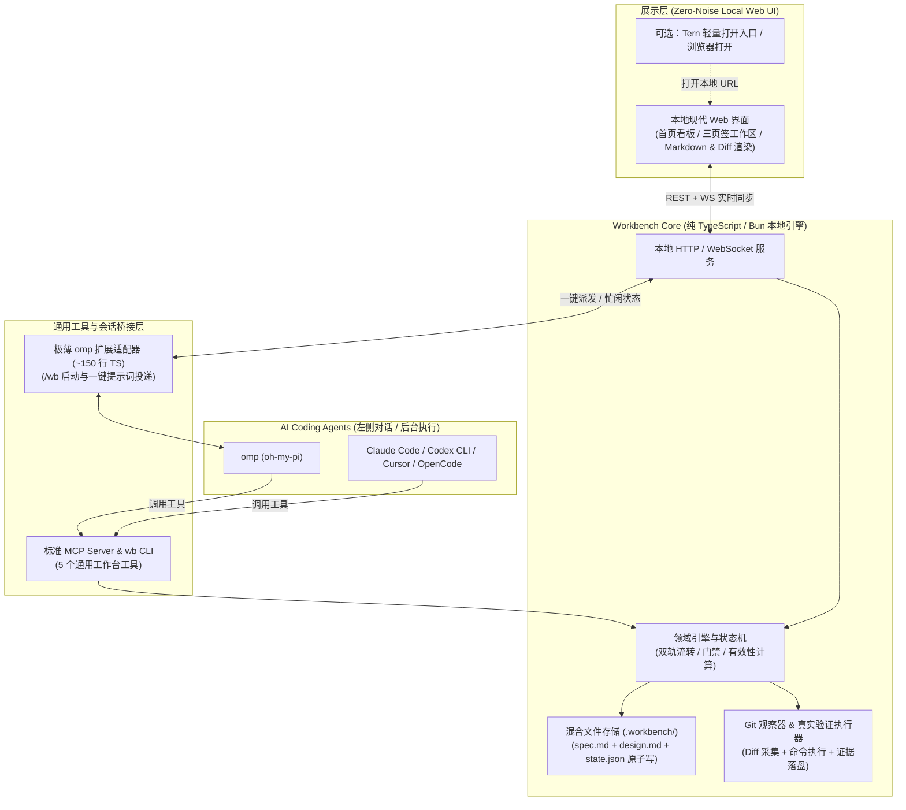

# Workbench 架构与产品设计规范（SDD + VDD 解耦版）

> 状态：当前权威设计基线（Option B：Headless Core + 通用 MCP/CLI + 本地极简 Web UI）。  
> 文档分工：本文定义产品定位、工作流、三层解耦架构、界面信息架构与通用 Agent 工具接口；数据与领域不变量见 [DOMAIN_CONTRACT.md](DOMAIN_CONTRACT.md)；实施与验收进度见 [TASKS.md](TASKS.md)；旧版 Tern-Luau 单体架构与 AF 系列文档已归档至 [archive/README.md](archive/README.md)。

---

## 1. 产品定位与核心设计哲学（Lightweight SDD + VDD）

**定位**：本地优先、Agent 无关的**轻规范与验证驱动交付工作台（Spec & Verification Workbench）**。它不是另一个聊天客户端，也不是繁琐的行政审批后台，而是开发者统筹多个需求、对齐 AI 意图、审阅真实交付证据的控制中心。

**核心公式**：

> **清晰意图（Living Spec） + 弹性执行（Adaptive Track） + 真实证据（Verification Proof） + 两头人工拍板（Human Checkpoints）**

本设计汲取了 `OpenSpec`（可读 Markdown 活规范）、`Vibe Kanban`（本地服务 + Web UI + 双向 MCP）、`Beads`（Agent 友好的极简状态记忆）与 `Spec Kit`（关键人工检查点）的工程精华，并吸收了业界对第一代重型瀑布式 SDD 的反思，确立以下四大核心原则：

### 1.1 四大原则

1. **Agent 填表搬砖，人类阅读拍板**
   - 彻底消灭用户作为“人肉中间件”的手工操作（不再要求用户手填 JSON 路径、手贴聊天摘录、手动导入候选、逐条新建实施步骤或维护文件哈希）。
   - 用户只需用一句话描述目标；标题拆解、范围界定、验收条件梳理、方案撰写、步骤更新与测试运行，全部由 Agent 通过工作台工具自动完成。
2. **守住两头，放开中间**
   - 不对 Agent 的每一次工具写入、每一行计划修改做繁琐的令牌授权或人工盖章。
   - 人类只守住真正决定工程质量的两道关口：
     1. **写代码前**：审阅并批准规范/方案（或显式授权走快速通道）。
     2. **交付完成前**：审阅真实的验证命令证据（`Verification Evidence`）与代码差异（`Git Diff`），点击验收通过。
3. **双轨自适应工作流（Plan-First vs Fast-Track）**
   - **标准模式（Plan-First）**：适用于复杂功能、架构调整与多人/多模块改动。流程为：  
     `draft（提需求）` → `designing（Agent 生成 spec.md / design.md）` → `awaiting_approval（人审阅并批准方案）` → `implementing（Agent 编码、更新任务、跑验证）` → `awaiting_acceptance（人看证据与 Diff 验收）` → `done`。
   - **快速通道（Fast-Track）**：适用于明确的小特性、局部修 Bug 或脚本维护。支持从 `draft` 直接点击 **「快速通道：直接实施」** 跳过长篇方案审批，直接进入 `implementing`；但编码完成后仍须经过同等严格的**真实验证证据 + 人工验收**闭环。
4. **零废话 UI（Zero-Noise Interface）**
   - 主界面只展示**业务事实**（需求目标、方案正文、任务进度、验证绿/红状态、代码 Diff）和**当前唯一的核心行动建议**。
   - 彻底清除免责声明式的系统说教（`note`）、内部 `UUID`、`SHA-256` 指纹、双修订号和协议术语；内部诊断信息仅收纳于「更多 → 复制调试信息」中按需查看。

---

## 2. 系统总体架构（三层解耦）

彻底放弃“Windows Tern Luau + 内嵌 PowerShell + TS 扩展三重校验”的耦合形态，重构为单一技术栈（**TypeScript / Bun**）驱动的三层清晰架构：

### 2.1 分层职责

1. **核心引擎层（Workbench Core — 纯 TypeScript / Bun）**
   - 直接运行在项目所在操作系统（Linux / WSL / macOS 原生文件环境），**彻底移除 Windows PowerShell 子进程与 Luau 重复校验器**。
   - 负责 `.workbench/` 混合存储的原子读写与乐观锁（CAS）、双轨状态机流转、批准与证据有效性评估、原生 Git 变更观察与 Diff 生成、以及项目内验证命令的真实执行与日志落盘。
   - 内置轻量本地 HTTP + WebSocket 服务，状态变更实时推送到前端。
2. **通用工具与桥接层（Agent Interfaces）**
   - **标准 MCP Server & `wb` CLI**：工作台能力通过标准协议暴露，天然支持 `omp`、Claude Code、Codex CLI、Cursor、Gemini CLI、OpenCode 等任意 Agent，不绑定特定模型或单一终端客户端。
   - **极薄 `omp` 会话桥接适配器（`omp/index.ts`，目标 ~150 行）**：仅负责两件轻量化事情——① 在 `omp` 会话中提供 `/wb` 命令启动或打开工作台；② 将用户在 Web UI 点击「让 Agent 生成方案」「开始实施」等按钮生成的结构化指令投递到绑定的 `omp` 会话，并同步会话空闲/忙碌指示灯。
3. **展示层（Local Web UI）**
   - 由 `Workbench Core` 直接提供单页 Web 应用，彻底摆脱 Tern Luau 原生组件的焦点丢失、列表无法恢复滚动、无语法高亮 Diff、手写光标计算等底层局限。
   - 原生支持完整的 Markdown 渲染（GFM、代码块、表格、任务列表）、Unified/Split 代码 Diff 视图、可折叠终端输出日志、亮/暗色主题切换以及全键盘快捷导航。
   - 用户可通过终端输出 URL 在浏览器访问，或在 Tern 中通过轻量入口直接唤起，不再需要维护 3000+ 行 Luau 界面胶水代码。

---

## 3. 信息架构与极简界面设计

借鉴 `Linear` 的克制密度、`AWS Kiro` 的活规范结构与 `Vibe Kanban` 的任务控制中心布局，界面压缩为两个核心层级：**全局首页** 与 **需求工作区**。

### 3.1 全局首页（Mission Control）

- **顶部工具栏**：
  - 左侧：项目名称 + Agent 会话连接状态指示灯（绿点在线 / 灰点离线，仅占 1 个小圆点加 2 个字，不展示复杂 UUID）。
  - 中间：搜索框（按编号、标题、正文实时过滤）+ 范围切换（`活跃 | 已完成 | 全部`）。
  - 右侧：视图切换分段控件（`列表 | 看板`）+ 唯一主按钮 **`+ 新建需求`**。
- **置顶「待你拍板（Needs Your Decision）」区**：
  - 只有当存在 `awaiting_approval`（方案待批准）、`awaiting_acceptance`（验证已通过待验收）或 `blocked`（受阻）的需求时才动态出现；没有待办时完全隐藏，不占空间。
  - 每条只显示：`REQ-002 · 标题 · 原因标签（如“方案已提交，待批准”） · [去处理 →]`，点击直达对应需求。
- **主体内容区**：
  - **列表视图**：干净的分割线列表，每行只保留 4 个要素：`编号`、`标题`、`当前阶段状态与一句话进展（如：实施中 · 任务 3/5 · 验证 2/2 通过）`、`相对更新时间`。
  - **看板视图**：仅展示四个只读投影列：**`准备中`**（draft / designing / awaiting_approval）、**`执行中`**（implementing）、**`待验收`**（awaiting_acceptance）、**`已完成`**（done）；受阻需求集中置顶/独立提示，不平铺 8 个内部阶段，不支持无效的“拖拽改状态”。
- **极简新建需求弹窗**：
  - 默认只有**一个多行输入框**（`“你想实现或修复什么？”`），支持直接粘贴需求描述，无需强制填写标题、标签、优先级或验收标准。
  - 提供两个按钮：
    - 主按钮：**`创建并让 Agent 整理方案`**（保存草稿并立即投递给绑定的 Agent，由 Agent 自动提炼标题、范围、验收条件与技术方案）。
    - 次按钮：**`仅保存草稿`**（适合先记录灵感，稍后再做或走快速通道）。

### 3.2 需求工作区（Workspace）

进入某个需求后，永远保持 **“紧凑单顶栏 + 动态决策横幅 + 三个平行页签”** 结构，彻底消除多层嵌套 Tab 与重复信息卡片：

1. **紧凑顶栏**：
   - `← 工作` | `REQ-001` | **需求标题** | `状态徽章` | `⋯ 更多`（内含：编辑原文、切换快速通道、标记受阻、取消需求、重新打开、复制调试信息）。
2. **动态决策横幅（Action Banner —— 全页唯一视觉焦点）**：
   - 紧贴顶栏下方，用一句清晰人话总结现状，并给出当前阶段**唯一的推荐主按钮（Primary CTA）**及最多 1–2 个必要次级动作：

| 当前现状 | 横幅展示文案示例 | 主按钮（Primary） | 次级动作（Secondary / Ghost） |
| :--- | :--- | :--- | :--- |
| `draft`（刚创建） | 需求草稿已保存，尚未生成方案 | **`让 Agent 整理并出方案`** | `快速通道：直接实施` |
| `designing`（Agent 编写中） | Agent 正在整理规范与技术方案… | *（显示运行中指示）* | `查看进度` / `取消等待` |
| `awaiting_approval`（待批准） | Agent 已提交方案与 N 项验收标准，请审阅 | **`批准方案并开始实施`** | `仅批准方案` / `提出修改意见…` |
| `implementing`（未开始或进行中） | 方案已批准（或快速通道已开启），正在实施（任务 x/y） | **`继续让 Agent 实施`**（空闲时）或 **`运行全部验证`** | — |
| `implementing` / 验证失败或过期 | 有 K 项验收条件未通过，或代码改动后验证已过期 | **`重新运行验证`** | `让 Agent 修复失败项` |
| `awaiting_acceptance`（全部通过） | 所有必需条件已验证通过（N/N），共改动 M 个文件 | **`验收通过（完成）`** | `打回修改…` |
| `blocked` / `done` / `cancelled` | 显示阻塞原因或最终完成/取消摘要 | `done/cancelled` 可从更多菜单重新打开 | `解除阻塞` |

3. **三个平行内容页签（无二级嵌套 Tab）**：
   - **Tab 1：`规范与方案（Spec & Design）`**
     - **目标与范围（`spec.md`）**：渲染后的干净 Markdown 正文（支持右上角点击轻量编辑）。
     - **验收条件清单（Acceptance Criteria）**：结构化列表，直接显示每条条件的**必需/参考**标记、绑定的测试命令，以及实时验证状态（`✓ 通过` / `× 失败` / `⟳ 代码已变需重跑` / `○ 未验证`）。
     - **技术方案（`design.md`）**：渲染后的 Markdown 方案正文；若存在历史已批准版本，右上角提供切换对比 Diff 的轻量开关。
   - **Tab 2：`变更与验证（Changes & Verification）`**
     - **实施任务（Tasks）**：Agent 在执行过程中自动勾选的步骤清单（`[✓] / [●] / [ ]`）。
     - **验证证据（Evidence）**：按验证命令分组，显示命令原文、退出码、耗时、当前代码快照匹配状态；支持展开查看完整终端输出，支持单条或一键 **`[重跑验证]`**。
     - **代码改动（Git Diff）**：以侧边文件树 + 主区语法高亮 Unified/Split Diff 的形式展示自基线以来的所有改动。
   - **Tab 3：`时间线（Timeline）`**
     - 面向人类的简洁事件流（创建、提交方案、批准、验证执行、打回、验收完成），屏蔽底层轮询噪音。

---

## 4. 通用 Agent 工具接口设计（MCP Server & `wb` CLI）

工作台通过**标准化 MCP Server** 与 **同名 `wb` CLI** 向任意 AI Coding Agent 暴露同一组 **5 个正交、低 Token 消耗的工具**。无需任何私有握手、租约配额或会话令牌注入：

| 工具名 | 用途 | 关键入参 | 权限与不变量约束 |
| :--- | :--- | :--- | :--- |
| **`wb_list`** | 查询项目需求摘要列表 | `status?`, `scope?` (`active`/`all`) | 只读；返回编号、标题、阶段、轨道及条件通过数。 |
| **`wb_get`** | 获取单个需求的完整上下文 | `id` (`REQ-001`), `includeDiff?` | 只读；返回 `spec.md`、`design.md`、验收条件与验证状态、任务列表及最新人工反馈。 |
| **`wb_propose`** | 提交/更新需求规范与技术方案 | `id`, `title?`, `spec?`, `criteria?`, `design?`, `summary` | 写入 `spec.md`/`design.md`/验收条件，并将 `plan_first` 需求推入 `awaiting_approval`。 **护栏**：若原需求已批准且本次修改了核心规范或必需条件，强制清除旧批准并重新置为 `awaiting_approval`。 |
| **`wb_update_tasks`** | 维护实施计划步骤或标记阻断 | `id`, `tasks` (增删改状态 `pending`/`in_progress`/`done`/`blocked`), `readyForAcceptance?`, `note?` | 仅允许操作任务清单与自查说明；当 `readyForAcceptance=true` 时，由引擎核对验证证据全绿后自动推入 `awaiting_acceptance`（若证据未全绿则拒绝推入并告知原因）。 |
| **`wb_verify`** | 在项目根目录执行真实测试/检查命令 | `id`, `command`, `criterionIds[]`, `timeoutMs?` | **禁止 Agent 传入结果状态**。由工作台 Core 真实执行命令、采集 `exitCode`、截断/脱敏输出并绑定当前 Git 快照写入 `evidence/`，同时返回最新条件覆盖情况。 |

### 4.1 明确禁止暴露给 Agent 的能力
- **禁止暴露 `approve`（批准方案）与 `accept`（最终验收）工具**：这两项拍板动作只能由人类在 Web UI 点击触发。
- **禁止 Agent 直接修改历史 `evidence/` 或强行覆写 `passed` 状态**：验证证据只能由 `wb_verify` 执行器产生。

### 4.2 `omp` 与其它 Agent 的协作方式
- **通用模式（Claude Code / Codex / Cursor / OpenCode / omp）**：在各自配置中挂载 `wb` MCP Server（或直接允许 Agent 调用 `wb` CLI 命令），Agent 即可全程自主读取需求、更新方案与任务、跑通测试并推送到待验收状态。
- **`omp` 增强模式**：通过极薄的 `omp/index.ts` 扩展，支持在 `omp` 终端输入 `/wb` 一键启动本地服务并打开工作台，同时允许用户在工作台点击按钮时直接把提示词发往当前活跃的 `omp` 会话，省去复制粘贴。

---

## 5. 新旧架构与设计取舍对照

| 维度 | 旧版设计（2026-11-16 归档） | 新版设计（Option B 解耦基线） |
| :--- | :--- | :--- |
| **运行核心与语言** | Luau (`host.luau` 3,195行) + 内嵌 PowerShell/C# + TS 扩展，三端重复校验 | **纯 TypeScript / Bun 单一核心**，Linux/macOS/WSL 原生读写与执行 |
| **UI 载体** | 强绑定 Tern Luau 原生控件（受限于焦点、滚动、Diff 与表格表达力） | **现代本地 Web UI**（完整 Markdown、高亮 Diff、键盘流、响应式） |
| **存储格式** | 多文件纯 JSON（v1/v2/v3，大量转义正文、实体/内容双修订） | **可读 Markdown (`spec.md`/`design.md`) + 轻量 `state.json`** |
| **工作流灵活性** | 单一重型 6 步流程，大小任务一刀切 | **Plan-First + Fast-Track 双轨自适应**，两头拍板、中间放开 |
| **Agent 协议复杂度** | 3 次握手 + 6 秒心跳 + 64-token 租约 + JCS 哈希 + 7 态账本 | **5 个标准 MCP 工具 + `wb` CLI + 单文件原子写入与乐观锁** |
| **信息密度与噪声** | 满屏免责 `note`、UUID、SHA-256、多层嵌套 Tab、手填表单 | **零废话 UI**：动态决策横幅 + 三平行页签，Agent 填表、人看结论 |
