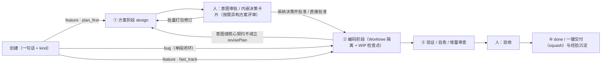
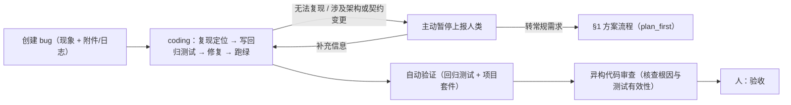

# 需求 / Bug 全流程规范（v2 精炼终稿）

> 状态：已定稿（v2，经独立复审并吸收 Conductor / Codex App / Vibe Kanban / Cursor / Anthropic Harness 工程实践）。
> 产品北极星：**高效性 + 准确性 + Token 与额度的极致优化利用**。
> 核心范式：**强模型 + 轻规则 + 零误报硬不变量**——管住两头（人类意图、真实运行证据），放开中间（释放强模型判断力，不做过程微管理与伪机器门禁）。
> 演进原则：**随模型变强主动做减法**——每条流程脚手架都必须有明确理由；一旦前沿模型原生就能稳定做好，果断删除外围约束，保持系统长期轻盈。

## 0. 总览

持久状态维持 4 态：`planning` → `coding` → `done` / `cancelled`。新增需求属性 `kind: feature | bug`。路由维持现有 **3 角色极简结构**（`defaultLead / sotaLead / reviewer`），不增设额外角色。

---

## 1. 常规需求方案阶段（`kind: feature`）

### 1.1 步骤构成与轨道边界
- 创建需求不调用 agent，仅保存原始输入为 `spec.md` 与只读 `originalGoal`。
- **一次 `design` 运行**同时完成：细化 `spec.md`、撰写 `design.md`、声明验收条件、以及（仅当存在真实分叉时）输出可选结构化待拍板项。不拆分为“梳理”与“设计”两步。
- **Fast-Track**：仅保留给明确的小型需求（文案、配置、样式等）。跳过方案审批直接进入 `coding`，验收阶段仍须满足同等严格的真实验证证据与人工验收闭环。

### 1.2 硬不变量 vs 软指引（杜绝“强规则、弱模型”）

| 类型 | 内容 | 守门位置 |
|---|---|---|
| **硬不变量（零误报阻断）** | ① `spec.md` 非空 ② `design.md` 非空 ③ 至少 1 条验收条件（可执行命令或明确标注 `manual` 及人工检查步骤） | ①② 在提交时检查；**③ 守在「批准进入 coding / 最终验收」关口**——若首轮方案附带未决决策卡片，允许暂缓补齐验收条件，避免逼模型先猜后编 |
| **软指引（Prompt 引导）** | 目标/非目标、核心实现思路、关键改动范围、风险与边界、待确认分叉 | 强模型按复杂度自适应详略，不强制固定章节、不逼写“无” |
| **明确不做** | ❌ 多章节强制 Schema 拒收 ❌ `file:line`/符号阻断式静态核验 ❌ Feature 阶段在 baseline 强跑“必须失败”的条件试跑 ❌ 工具调用次数上限或负向禁读清单 | 砍除 |

### 1.3 异构方案评审（按需触发，非全量强制）
- 常规 `plan_first` 需求默认**不强制**跑方案评审，避免每次都被拖成 `design → review → revise` 3 轮串行。
- 触发方式：`sota` 档位默认开启，或人类在审批页**一键按需触发「异构评审方案」**。

### 1.4 人类审批与 UI 交互设计
**不采用阻塞式模态弹窗（Modal）**（会遮挡待对照的方案正文、打断多项目异步工作流，且与非交互 CLI 短进程模型不匹配），按发起方分工：

| 场景 | 发起方 | UI 形态 | 行为与价值 |
|---|---|---|---|
| **方案选型、边界歧义、风险取舍** | Agent → 人 | **内嵌结构化决策卡片**（置顶在审批区顶部，非遮挡、状态持久化） | 仅当 Agent 确实遇到需拍板分叉时出现，否则零噪音；每题含问题描述 + 2–4 个选项（标出推荐项）+ 自定义输入；左栏红点同步计入待拍板；支持对照正文异步勾选 |
| **对任意细节有异议、追问、微调措辞** | 人 → Agent / 文档 | **保留现有段落级行内批注（`Ask` / `Refine`）+ 直接编辑文档** | 自由度高、锚定上下文，小改动直接编辑比走一轮 Agent 更快 |

**审批页核心信息流**：
1. **你的原始需求原话（`originalGoal`）**：原样置顶展示在 `spec.md` 上方（不做满屏红绿的字符级 diff），一眼对照是否跑偏。
2. **待拍板决策卡片**（仅存在未决项时置顶显示）。
3. **方案正文、验收条件与（如有）异构评审意见**。

**批量提交，极简双出口**：
- **「采纳选择并直接批准进入编码」**：分叉选项本身已写清时，**不重写原 `design.md`**（零文档改写冲突），直接将已拍板的 `Q&A` 固化为 `humanDecisions` 置顶注入编码 prompt 并进入 `coding`，省去一整轮 `design` 修订。
- **「提交决策并修订方案」**：一次性打包**全部卡片答案 + 全部未解决行内批注**触发下一轮 `design`，避免一问一答多轮空转。

### 1.5 交接到编码与执行期方案一致性
- **同模型、新会话**：编码沿用该需求当前档位的主程模型（会话亲和），`design → implement` **始终开新会话**；权威事实源为已批准的 `spec.md` + `design.md` + `humanDecisions` + 有界 `handoff.md`。
- **分层执行弹性**：`design.md` 是意图契约与方向指引，不是逐行施工图。编码中允许强模型自主调整局部实现细节（在完成说明中交代）；仅当**需求意图、公共接口/数据契约或核心路线**不成立时，才触发 `revisePlan`（`coding → planning`，作废 `approval`，当前 `git diff` 存入 handoff，工作区保持不动）。

### 1.6 方案阶段与全局 Prompt 效率优化（吃满缓存、消除信息差）
1. **Prompt 缓存友好结构（全局适用）**：所有阶段（`design` / `coding` / `review`）统一将**静态稳定前缀置顶**（系统指令 → `AGENTS.md` → 稳定 `spec.md`），将**每轮变化内容置底**（`revision`、最新报错、当前 diff、人类追加反馈），最大化命中底层模型 Prompt Cache，直接削减重复输入 Token 与首字延迟。
2. **Prompt 内联与单次提交**：直接注入 `spec` 全文、`lastFeedback`、未解决批注与提交格式示例，取消反复回读与协议摸索（`wb --help/get`）。
3. **隔离无关全局配置**：在 harness 能力允许时屏蔽无关用户全局 skills / hooks 噪音。

---

## 1B. Bug 修复流程（`kind: bug`）

Bug 的不确定性在定位根因与复现，且定位与修复强耦合；不强行拆成 `diagnose → 机器门禁 → fix` 两段，也不走 §1 的方案审批文档流。

- **单段连贯上下文**：直接进入 `coding`，在一个连续会话内完成复现、定位、补回归测试与修复。
- **防假修靠真实闭环而非脆弱脚本**：要求修复附带覆盖该问题的回归测试，并**必跑异构代码审查**核查根因与测试有效性（不做脆弱的 baseline 反跑脚本）。
- **由模型自主判断升级**：不设“>5 文件”等机械阈值；仅在无法复现或修复突破公共契约/架构时主动暂停上报。

---

## 2. 编码阶段

### 2.1 Worktree 默认隔离、环境引导与并发安全
- **默认 worktree 沙箱隔离**：Git 项目进入 `coding`（`approve` / `fast_track` / `bug`）时，默认自动创建独立 worktree 沙箱，主工作区始终保持干净、支持多需求真正并行；仅非 Git 目录或用户显式关闭时回退主工作区。
- **Worktree 环境引导（补齐多语言与本地配置短板）**：
  - 支持项目根目录 `.worktreeinclude`（或项目配置 `copyFiles`），建沙箱时自动复制 `.env` / `.env.local` 等 gitignored 本地配置；
  - 支持可选项目级 `setupScript`（如离线装依赖或 CoW 克隆 `cp --reflink=auto` / `cp -c`），沙箱创建后自动执行一次，替代单一易污染主仓库的 `node_modules` 软链接。
- **按 `codeRoot` 读写互斥锁**：允许同目录并发只读任务（`ask` / `review`），严格禁止两个写任务（`implement` / `fix`）同时写入同一 `codeRoot`。
- **开写前零风险对齐主干**：首次 `implement` 启动前，若沙箱干净且无相对 `baseHead` 提交，自动快进同步最新主干；已有改动后不再自动动分支。

### 2.2 沙箱自动 WIP 检查点（Git Commits as Memory）
- 在独立沙箱分支（`feat/REQ-xxx`）中，**每轮写运行结束或进入审查前，由 Hub 自动打一个轻量 WIP checkpoint commit**（最终合入主干/提 PR 时一键 squash 成干净提交）。
- 价值：① 增量复审直接 `git diff <lastReviewCommit>..HEAD`，100% 精确；② 某轮 `fix` 改崩可一键回滚至上一检查点；③ 限流/超时接力天然持久化进度；④ 零污染主干。

### 2.3 会话续接、缓存经济学与破局策略
- **维持同档会话亲和**：`implement ↔ fix` 沿用当前档位主程模型，绝不自动升级消耗 SOTA 额度。
- **尊重 Prompt Cache，不过早强切**：原生续接上限保持在模型上下文窗口的高有效区间（约 **65%–70%** / 尊重 CLI 内置 compaction，不草率硬切 `100k`），最大化复用 KV Cache 降本提速。
- **按失败结果破局（Anti-Loop）**：同一失败原因触发自动修复时，**第 1 次 `fix` 续接原会话**（吃满缓存、热上下文秒修小错）；若仍失败触发**第 2 次 `fix`，强制开新会话（`fresh_handoff`）**，主动打破思维定势。

### 2.4 运行容错与零误报防线
- **中途限流自动接力**：取消 `durationMs < 60_000` 限制；编码期间无论运行多久遇到 429 限流，均自动以 `fresh_handoff`（基于当前 WIP 检查点/diff）单跳切至同档备援接力。
- **零改动硬保护**：`implement` 正常退出但相对 baseline 0 改动时，禁止自动标为“就绪待验收”，明确提示「未产出代码改动」交人核查（同时允许人确认无需改动后直接关闭，避免死锁）。
- **收紧无输出看门狗**：编码 `idleTimeout` 从 `15 min` 收紧至 **`8 min`**（任何流式输出或工具调用均重置计时）。

### 2.5 验证复用与诚实信号
- 维持现有 `wb verify` 与同快照 `verify-cache`，绝不轻信普通 shell 日志签发验证证据。
- **`fast_track` 诚实信号**：若一条需求最终仅有系统自动注入的通用基线命令（如 `typecheck`）、无本需求专属测试，验收页明确标示「仅通过项目基线检查，无专属测试，请重点核对 Diff」。

---

## 3. 验证、自愈与交付审查

### 3.1 验证与自愈止损
- 维持快检先行 → `failFast` → 全量套件分层执行与 `verify-cache`。
- **失败快速分流**：命令不存在（`exit 127`）、验证超时（`timedOut`）等明确基础设施/环境故障，**不派模型盲目 `fix`**，直接提示环境异常交人处理；仅对真实编译/测试断言失败触发自动自愈（上限 2 次，绝不自动升 SOTA；第 1 次续接，第 2 次开新会话破局）。
- **自愈耗尽显式升级**：达到上限仍失败时，明确派生 `needs_human` 状态并计入左栏红点，Banner 直达：**「升级 SOTA 主程接管」** / **「退回修改方案（`revisePlan`）」**。

### 3.2 交付审查闭环（高效 + 准确 + 控额度）
- **极简轨道触发规则（保持 3 角色不变）**：
  - `plan_first` 与 `bug` 默认自动跑异构审查（项目开关可关）；
  - `fast_track` 默认不自动审（保留人工一键触发）；
  - 不按文件后缀/行数维护脆弱的启发式跳过规则。
- **有封顶的 `block` 自动闭环（硬上限 1 轮）**：
  - 初审返回 **`block`** → 自动把 findings 交给同档主程跑 **1 次 `fix`** → 验证通过后**自动跑 1 次复审**。
  - 复审若仍未 `pass`，**立刻停下交人拍板**，绝不让两个模型无限互殴烧额度。
  - 初审返回 **`concern`** → **不自动触发 `fix`**，直接交人选择「接受风险验收」或「一键去修」。
- **逐条核销阻塞项**：交接每条阻塞 finding 时附上最小复现与预期行为。修复后提供覆盖该复现的回归用例或可复现验证证据。复审在对应的代码快照上逐条确认，并检查本次改动触及的相邻行为是否回归。
- **引擎补齐 `block` 过期硬防线**：若上一份审查为 `block` 且因改代码变为 `stale`，跳过复审直接验收必须填写 `overrideReason`，与 `current block` 一致。
- **增量复审 + 续接审查会话（省 50%–70% 复审 Token）**：
  - 依托 §2.2 的 WIP 检查点，复审直接注入**「上轮 findings 清单 + 精确增量 Diff（`lastReviewCommit..HEAD`）」**；
  - 自动复审由同一 `reviewer` harness 执行且上轮上下文处于健康区间时，默认**原生续接上次审查会话**（吃满 Prompt Cache）；
  - 保留逃生舱：用户手动点击**「独立重审」**时强制开全新会话（`fresh_handoff`），消除潜在锚定偏差。

---

## 4. 验收与交付

保持 `done` = 人类验收完成，`delivery`（本地合入 / PR / 合并）作为 `done` 下派生子状态；PR 评审被打回时走 `reopen(preserveApproval: true)` 直接回 `coding`。

### 4.1 验收页聚焦呈现（一屏定生死）
集中展示 4 块高信噪比事实：① 可信度摘要（验证覆盖率、通用基线诚实标示、异构审查结论）；② 代码 Diff 与测试篡改告警；③ UI 截图对比（涉及 UI 时）；④ 出口按钮（「验收通过（可选顺手打开一键交付）」/「打回修改」/「推翻方案 `revisePlan`」）。

### 4.2 默认沙箱下的一键交付双出口
commit message 与 PR 标题/正文由 `spec` 及变更摘要自动预填（**零额外 LLM Token**），沙箱内的 WIP 检查点在交付时自动 squash 为干净提交：
1. **提交并创建 PR（GitHub / Gitee）**：沙箱分支 squash 提交 → `git push` → 创建 PR → PR 合并后自动快进主干并清理沙箱。
2. **一键合入本地主干**：沙箱分支 squash 提交 → fast-forward / 合并回本地主干 → 自动清理沙箱（遇冲突衔接现有冲突消解流）。

### 4.3 沙箱自动收尾与多沙箱联动
- 需求完成本地合入、PR 合并或被 `cancelled` 时，自动清理对应 worktree 与临时分支。
- 某需求合入主干后，自动快进该项目下**尚无改动**的干净沙箱，并对已有改动的活跃沙箱给出温和的漂移提示。

### 4.4 统一项目经验沉淀（融入 `AGENTS.md`）
- 在人类打回修改、验收备注或解决重要审查 `block` 时，提供轻量勾选框「记住这条项目经验」：默认直接追加一条精炼规则到仓库根目录 **`AGENTS.md`**（若项目无 `AGENTS.md` 则落盘 `.workbench/playbook.md`），让 Workbench 及外部所有 Coding Agent 共享同一份受版本控制的活文档，严格保持条目精炼不膨胀。

---

## 5. 全局实施路线图（精简版，按 ROI 与依赖排序）

### Phase 1：基础设施止血 & 立刻省 Token（最高 ROI）
1. **Worktree 默认隔离 + `.worktreeinclude` / `setupScript` + 按 `codeRoot` 目录写锁 + 自动 WIP Checkpoint Commit**（§2.1, §2.2）
2. **审查 `block` 闭环（封顶 1 轮）+ 过期 `block` 强制 `overrideReason`**（§3.2）
3. **增量复审（`lastReviewCommit..HEAD`）+ 同 harness 原生续接（含「独立重审」逃生舱）**（§3.2）
4. **Prompt 缓存友好排序（静态前置/动态后置）+ 编码容错**（第 2 次 `fix` 强制新会话破局、取消 429 的 60s 限制、0 改动硬保护、`idleTimeout` 8 min、环境失败不盲修）（§1.6, §2.3, §2.4, §3.1）

### Phase 2：人机交互与端到端流转收口
5. **方案阶段 Prompt 内联 + 单次提交 + 隔离无关全局 skills**（§1.6）
6. **审批页：原样置顶 `originalGoal` + 极简内嵌决策卡片（双出口：直接采纳注入 coding / 打包修订）**（§1.4）
7. **`revisePlan`（`coding → planning` + diff 入 handoff）+ 自愈耗尽 `needs_human` 直达「升级 SOTA / 退回方案」**（§1.5, §3.1）
8. **默认沙箱一键合入本地主干（自动 squash & 预填 commit/PR）+ 取消/合入自动清理与干净沙箱快进**（§4.2, §4.3）

### Phase 3：Bug 专属闭环、按需方案评审与长期复利
9. **`kind: feature | bug` 分流**：Bug 单段闭环直入 `coding` + 必跑异构审查（§1B, §3.2）
10. **按需异构方案评审**（`sota` 默认或审批页一键触发）（§1.3）
11. **`fast_track` 验收页诚实标示 + 验收页 4 要素收口**（§2.5, §4.1）
12. **勾选沉淀项目经验至 `AGENTS.md` + 同步清理 `DESIGN.md` 路由文档漂移**（§4.4）
